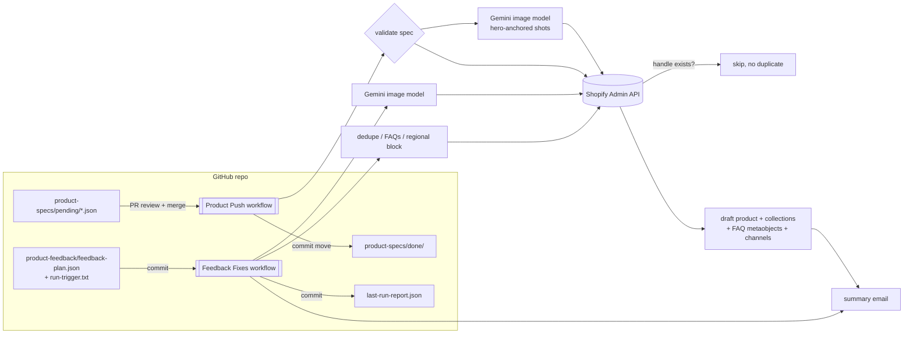

# Shopify Product Listing Pipeline

Git-driven catalog onboarding for Shopify. A product spec (one JSON file) is committed to a folder. A GitHub Actions workflow turns it into draft Shopify products, with AI-generated photos, structured FAQs, collection assignments and a summary email. A second workflow applies review feedback to listings that already exist.

## The problem

A multi-channel e-commerce business sold the same products to consumers (retail) and to shops (wholesale), so every new product meant two listings with different titles, size and price ladders, copy, photos, FAQs and collections. Done by hand in the Shopify admin, mistakes were easy to make and hard to see: a wrong collection, a re-created listing that Shopify quietly renamed to `handle-1`, photos that didn't match each other. Nobody could review a listing before it existed, and there was no record of who listed what or when.

## What it does

**Onboarding (`push-product.js`)**

1. A spec JSON is added to `product-specs/pending/` in a pull request. The spec holds titles, SEO fields, descriptions, sizes and prices or custom variants, FAQs, tags and channels. Reviewers can read exactly what will go into the store.
2. When the PR is merged, the **Product Push** workflow runs. For each spec it:
   - validates the spec and fails fast on missing fields or a malformed handle
   - generates retail and wholesale photo sets with a Gemini image model, using shot lists from `config/image-rules.json`. Every shot is anchored to the first hero image, so all the photos show the same product.
   - creates each listing in Shopify as a **draft**, adds it to collections from `config/collections.json`, and stores FAQs as metaobjects (`custom.faqs`)
   - optionally attaches per-variant images, for example one image per flavor generated from that flavor's label art, and pins each image to its variant
   - publishes the product to all sales channels (it is set Active for a few seconds to do this, then returned to draft), so going live after review only takes the status change
   - emails a summary with admin links, live URLs, prices and FAQ counts, including any specs that were skipped
3. The processed spec is moved to `product-specs/done/` and committed back, so the git log records what was onboarded and when.

**Feedback loop (`product-feedback-fixes.js`)**

After reviewing the drafts, the reviewer writes the problems into `product-feedback/feedback-plan.json`, for example "this shot has a timestamp burned in", "these two listings are duplicates" or "this product needs FAQs". Committing `run-trigger.txt` starts the **Product Feedback Fixes** workflow. It can:

- regenerate, add or replace specific images, in one of five modes (`add`, `add_main`, `replace_match`, `keep_first_redo_rest`, `redo_all`), using a reference photo from the same product or a different one
- add FAQs to products that don't have them yet
- add a versioned "international availability" block to product descriptions, or upgrade an older version of it in place
- merge duplicates: copy images to the listing being kept, archive the duplicate, and create a 301 redirect

Each run writes `product-feedback/last-run-report.json`, which is committed, and sends a summary email.

## Architecture



| Path | Purpose |
|---|---|
| `push-product.js` | Spec → draft product pipeline |
| `product-feedback-fixes.js` | Plan-driven fixes to existing listings |
| `lib/shopify.js` | REST + GraphQL client (retries on throttling), staged uploads, media operations |
| `lib/images.js` | Gemini image calls with reference anchoring; shot lists built from config |
| `lib/faq.js` | `faq_item` metaobject and `custom.faqs` metafield setup, idempotent |
| `lib/regional.js` | Versioned, marker-wrapped description block: insert, upgrade, or leave alone |
| `config/collections.json` | Spec `collection_key` → retail and wholesale collection IDs |
| `config/image-rules.json` | Photo styles, grade wording, reference prompts, shot-list archetypes |
| `config/regional-section.json` | International block template, version and target tag |
| `product-specs/examples/` | Two synthetic specs: a basic retail + wholesale pair, and a branded line with variants |

## Key design decisions

**Git as the interface.** The people who decide what to list don't need Shopify admin access or a custom UI. They open a PR with a JSON file. Review happens on the diff, and the merge is the approval. The pending → done move gives an audit trail without a database. Most specs were drafted by an AI assistant and reviewed by a person, and this setup handled that well: the assistant could commit specs through the GitHub API, but nothing reached the store until a person merged.

**Draft-only, human-in-the-loop.** Every product is created with `status: draft` and ends the run as a draft. The pipeline gets a listing to "ready to publish", and a person decides when it goes live. The summary email links straight to each draft in the admin.

**Idempotent by handle.** Before it creates anything, the script looks up the spec's `url_handle`. If a product with that handle already exists, the spec is skipped and the email says so. Shopify would otherwise create `handle-1`. This guard was added after a re-run produced exactly those duplicates, and the feedback loop's duplicate-merge mode was written to clean them up. The other write paths can also be re-run safely: collection adds ignore "already exists", FAQ setup checks for existing definitions and skips products that already have FAQs, the regional block is versioned and only rewritten when its version changes, and archived duplicates are skipped.

**Configuration, not code.** Collection IDs, image styles, shot lists and the regional block live in `config/*.json`. Adding a category or changing a photo rule is a reviewed config change. Shot lists are chosen by matching the spec's `product_type` against archetypes, so a new category usually doesn't need code.

**Guardrails on AI images.** Each prompt carries explicit negative constraints: no text, watermarks, labels or timestamps; gloved hands only; clean surfaces. These rules came from real review rounds, and the sample feedback plan shows a typical one, a camera timestamp burned into a generated photo. Every shot after the first passes the hero image as a reference, so the photos stay consistent. Branded products can instead pass label artwork, with a separate prompt that tells the model to reproduce the label exactly and not redesign it.

**Safe failure.** In batch mode, one bad spec doesn't block the others: it stays in `pending/` for a fix and retry, and the job exits non-zero. Gemini calls retry on 429 and 5xx errors, and GraphQL calls retry on throttling. The feedback fixer never deletes existing images unless replacements were generated and uploaded first. Duplicates are archived rather than deleted, so the change can be undone.

**Dry run everywhere.** `--dry-run` prints what would be created, including variant and image counts, without writing to Shopify. `--skip-images` turns off the paid image calls. Both scripts run locally with the same flags as in CI, and the workflows take the flags as a manual input.

**Observability.** Every run produces a summary email and an image artifact (generated photos kept for 30 days), and the feedback loop also writes a JSON run report committed to the repo. If SMTP isn't configured, the summary is printed to the job log instead of being lost.

## Setup

1. **Shopify custom app.** Create one with the Admin API scopes `write_products`, `write_publications`, `write_metaobjects`, `write_metaobject_definitions` and `write_online_store_navigation` (the last one is for redirects).
2. **Config.** Put your collection IDs in `config/collections.json`, and adjust `config/image-rules.json` and `config/regional-section.json` if you need to. To turn the regional block off, set `"enabled": false`.
3. **Environment.** Copy `.env.example` to `.env` for local runs. For GitHub, add the following under *Settings → Secrets and variables → Actions*:

   | Name | Type | Notes |
   |---|---|---|
   | `SHOPIFY_STORE` | secret | `your-store.myshopify.com` |
   | `SHOPIFY_ADMIN_TOKEN` | secret | Admin API access token |
   | `GEMINI_API_KEY` | secret | Google AI Studio key |
   | `SMTP_HOST` | secret | e.g. `smtp.example.com` |
   | `SMTP_PORT` | secret | `587` (STARTTLS) or `465` (TLS) |
   | `SMTP_USER` | secret | sending account |
   | `SMTP_PASS` | secret | SMTP or app password |
   | `NOTIFY_EMAIL` | secret | recipient of summary emails |
   | `STORE_NAME` | variable | used as default vendor and in emails |
   | `STOREFRONT_URL` | variable | e.g. `https://www.example.com` |

   `SHOPIFY_API_VERSION`, `GEMINI_IMAGE_MODEL` and `DEFAULT_INVENTORY` are optional overrides (repository variables in CI). Their defaults are in `.env.example`.

4. **Run locally**

   ```bash
   npm install
   cp product-specs/examples/sample-botanical-blend.json product-specs/pending/
   npm run push:dry                         # validate + preview, no writes, no image calls
   node push-product.js --batch             # live: create drafts
   node product-feedback-fixes.js --dry-run --skip-images
   ```

5. **Run in CI.** Commit a spec to `product-specs/pending/` on `main`, or use *Actions → Product Push → Run workflow* with args such as `--dry-run --skip-images`. For fixes, edit `feedback-plan.json` and commit `run-trigger.txt`. Its first line can carry flags such as `--only=handle-a --skip-text`.

### Spec format

The two files in `product-specs/examples/` cover the full format. Required fields are `product_name`, `product_type` and `sku_base`, plus, for each channel listed in `channels`, a `product_title`, `url_handle`, `short_description` and either `sizes[]` or `options[]` + `variants[]`. Optional fields: `vendor`, `collection_key`, `regional_section`, `image_urls` (existing photos, placed first), `image_prompts` (a custom shot list with optional `ref_url`/`ref_mode`), per-variant `image_url` or `image_ref_url`, `faqs`, `tags`, `product_schema_json`, `internal_links`.

## Results

In two batches in September 2026, the workflow processed and archived 18 specs: 9 retail + wholesale pairs and 9 single-channel listings for a branded line. The feedback loop went through at least five numbered review rounds. In the last recorded run it replaced the one wholesale image (of 9 checked in the previous round) that had a generated timestamp overlay, with 0 errors.

## Known limits

- No automated tests. Spec validation and `--dry-run` are the safety net.
- Image generation runs in sequence, so a batch of products with five to ten images each takes a while (the workflow timeout is three hours).
- New variants start at `DEFAULT_INVENTORY` units (999 by default, as in production) unless the spec sets `inventory_quantity`. That is a placeholder; real stock should come from the inventory system of record.
- To publish to sales channels, the product is set Active for a few seconds and then returned to draft. It is briefly visible to shoppers during that window. The step publishes to every channel or none; `--no-publish` skips it.

Extracted from a production automation suite I built and ran for a live e-commerce business, 2026.

---

© Michael Wootan. Source shared for portfolio review; all rights reserved.
